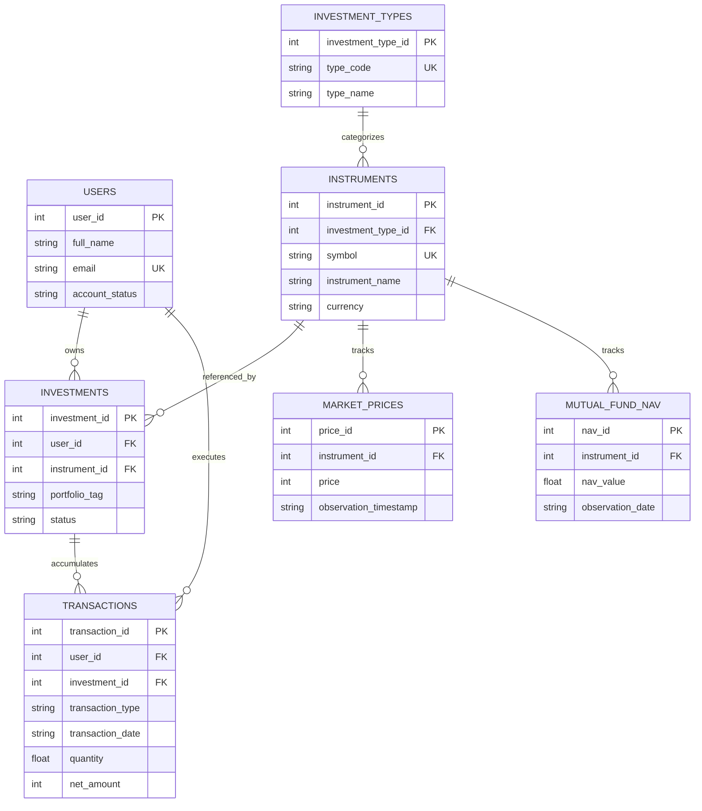
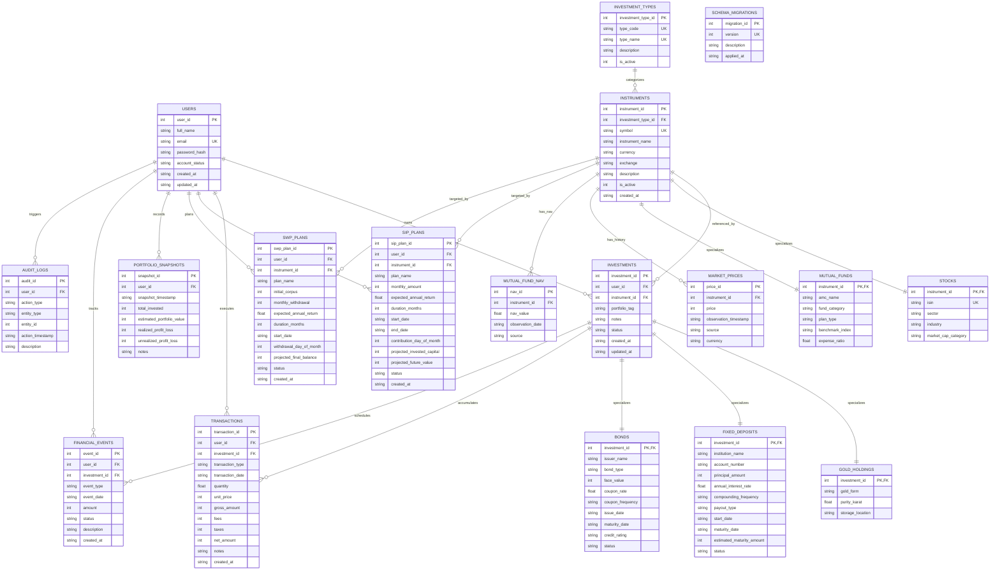

# InvestSphere — Entity-Relationship (ER) Documentation

## 1. Overview & Architectural Blueprint

The **InvestSphere** relational database is designed according to **Third Normal Form (3NF)** principles to ensure data integrity, eliminate update anomalies, and cleanly isolate shared market data from user-specific holdings.

A core architectural distinction in this schema is the separation between:
1. **Financial Instruments (`instruments`):** Market-level entities (e.g. AAPL, MSFT, Vanguard 500) containing symbol, company description, exchange, and market classification. Multiple users can invest in the same instrument without duplicating ticker metadata.
2. **User Investments (`investments`):** User-level holdings linking a specific `user_id` to an `instrument_id`, tracking portfolio tags, user notes, and holding lifecycle states.

---

## 2. Core ER Diagram (Simplified Model)

The following diagram highlights the central transactional and asset relationship spine:

---

## 3. Complete Relational ER Diagram

---

## 4. Entity Cardinality & Relationship Catalog

| Parent Entity | Child Entity | Cardinality | Relationship Description | Foreign Key Constraint |
| :--- | :--- | :---: | :--- | :--- |
| `users` | `investments` | `1 : N` | One user owns zero or more investment holdings | `ON DELETE CASCADE` |
| `users` | `transactions` | `1 : N` | One user records zero or more financial transactions | `ON DELETE CASCADE` |
| `users` | `sip_plans` | `1 : N` | One user saves multiple goal-oriented SIP calculations | `ON DELETE CASCADE` |
| `users` | `swp_plans` | `1 : N` | One user saves multiple retirement SWP calculations | `ON DELETE CASCADE` |
| `users` | `portfolio_snapshots` | `1 : N` | One user records periodic portfolio value snapshots | `ON DELETE CASCADE` |
| `users` | `financial_events` | `1 : N` | One user tracks scheduled financial calendar events | `ON DELETE CASCADE` |
| `users` | `audit_logs` | `1 : N` | One user triggers system and financial audit entries | `ON DELETE SET NULL` |
| `investment_types` | `instruments` | `1 : N` | One category (e.g. Stock) groups many market instruments | `ON DELETE RESTRICT` |
| `instruments` | `investments` | `1 : N` | One instrument can be held across multiple user portfolios | `ON DELETE RESTRICT` |
| `instruments` | `stocks` | `1 : 1` | Stock-specific metadata extends instrument (ISIN, sector) | `ON DELETE CASCADE` |
| `instruments` | `mutual_funds` | `1 : 1` | Fund-specific metadata extends instrument (AMC, category) | `ON DELETE CASCADE` |
| `instruments` | `market_prices` | `1 : N` | One instrument has historical timestamped spot quotes | `ON DELETE CASCADE` |
| `instruments` | `mutual_fund_nav`| `1 : N` | One mutual fund has historical daily NAV observations | `ON DELETE CASCADE` |
| `investments` | `gold_holdings` | `1 : 1` | User gold holding specifies purity and storage location | `ON DELETE CASCADE` |
| `investments` | `fixed_deposits` | `1 : 1` | User FD specifies bank, rate, tenure, and payout rules | `ON DELETE CASCADE` |
| `investments` | `bonds` | `1 : 1` | User bond specifies issuer, coupon rate, and maturity | `ON DELETE CASCADE` |
| `investments` | `transactions` | `1 : N` | One user holding accumulates buy, sell, and income trades | `ON DELETE RESTRICT` |
| `investments` | `financial_events`| `1 : N` | One investment holding generates maturity & coupon events | `ON DELETE CASCADE` |

---

## 5. Subtype Specialization Pattern (Table Inheritance)

To model diverse investment instruments without creating an un-normalized "god table" with dozens of NULL columns, InvestSphere implements the **Class Table Inheritance (Subtype Specialization)** pattern:

1. **Market Instruments (`instruments`):**
   - Base attributes common to all traded instruments: `symbol`, `instrument_name`, `currency`, `exchange`.
   - Specialization table `stocks` shares `instrument_id` as both Primary Key and Foreign Key.
   - Specialization table `mutual_funds` shares `instrument_id` as both Primary Key and Foreign Key.
2. **User Contracts (`investments`):**
   - User holdings common to all portfolio entries: `user_id`, `instrument_id`, `portfolio_tag`, `status`.
   - Specialization table `fixed_deposits` stores bank deposit terms (`principal_amount`, `compounding_frequency`).
   - Specialization table `bonds` stores debt parameters (`face_value`, `coupon_rate`, `credit_rating`).
   - Specialization table `gold_holdings` stores physical asset attributes (`purity_karat`, `gold_form`).

This design maintains strict data integrity, guarantees Third Normal Form (3NF), and enables polymorphic reporting.
